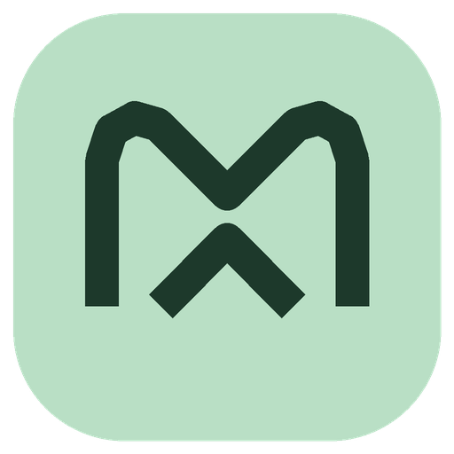

<p align="center">
  
</p>

<h1 align="center">Morrow</h1>

<p align="center"><strong>A little space for notes, code, and everything in between.</strong></p>

<p align="center">Free and open source · Windows x64 · 0.4.0 preview · <a href="LICENSE">MIT license</a></p>

<p align="center">
  <a href="#features">Features</a> ·
  <a href="#get-started">Get started</a> ·
  <a href="#ai-and-privacy">AI &amp; privacy</a> ·
  <a href="docs/USER-GUIDE.md">Full guide</a> ·
  <a href="#contributing">Contributing</a>
</p>

Morrow is a Windows text and code editor designed to be approachable for everyday notes and useful for quick programming tasks. Edit files without an account; AI assistance is optional.

> [!TIP]
> **Contributing?** Most of Morrow is platform-neutral TypeScript. `npm ci && npm test` and
> `npm run build` run on Linux and macOS too — you do not need Windows, Rust or MSVC Build Tools
> to contribute. See [CONTRIBUTING.md](CONTRIBUTING.md) for exactly which work needs Windows.

> [!IMPORTANT]
> **Early preview, not a production release.** Keep backups and test with non-critical files first. The Windows installer is unsigned, and consumer Windows 10/11, full accessibility and security audits, and performance benchmarks remain outstanding.


*Browser preview of the editor. The sample is not a saved file; Windows-native integration is not shown.*

## Choose your first run

- **Use the Windows app:** [download the latest preview and its checksum file](https://github.com/RANJITHROSAN17/morrow-editor/releases/latest). No Node.js or Rust is needed for a packaged installer. It is unsigned; keep backups and use non-critical files.
- **Evaluate the UI or contribute without Windows:** use the [browser UI preview](#browser-ui-preview); it does not verify native desktop behavior.
- **Build the native app:** follow [Windows app from source](#windows-app-from-source) and its toolchain prerequisites.

For your first desktop session, open a disposable text file, edit, save and reopen it before enabling optional AI features. Compare the installer’s SHA-256 against the attached `SHA256SUMS.txt`; in PowerShell use `Get-FileHash .\Morrow_0.4.0_x64-setup.exe -Algorithm SHA256`. A matching checksum verifies the downloaded bytes against that release’s checksum, not publisher identity or safety.

## Features

- **A familiar editor:** tabs, open/save dialogs, undo and redo, find and replace, line numbers, word wrap, and dark and light themes.
- **Code and writing:** syntax highlighting for many programming and markup formats, automatic or manual language selection, and a live, inert Markdown preview.
- **Folders and navigation:** add multiple folders to a workspace, create files and folders, search saved files across roots, and use quick open to navigate.
- **Review before applying:** compare a pasted replacement with a selected range, explicitly accept it, and undo it. Applying a change does not automatically save the file.
- **AI on your terms:** optional Ollama suggestions, a browser-first Arena workflow, and a separate optional Arena API panel. See [AI and privacy](#ai-and-privacy) before sharing text.
- **Recovery and file awareness:** optional session recovery and checks for external file changes. Recovery is unencrypted and is **not a backup**.

Morrow is not yet a full IDE: it does not provide a debugger, integrated terminal, extension marketplace, or language-server features. See the [full guide](docs/USER-GUIDE.md) for file formats, limits, shortcuts, and safety details.

## Get started

### Windows app from source

You will need Windows x64, [Git](https://git-scm.com/), [Node.js 20](https://nodejs.org/) or newer, current stable [Rust](https://rustup.rs/), Microsoft C++ Build Tools with **Desktop development with C++**, and the Microsoft Edge WebView2 runtime. See [Tauri's Windows prerequisites](https://v2.tauri.app/start/prerequisites/).

In PowerShell:

```powershell
git clone https://github.com/RANJITHROSAN17/morrow-editor.git
cd morrow-editor
npm ci
npm run tauri dev
```

To build an **unsigned** Windows x64 installer after installing the prerequisites and dependencies:

```powershell
rustup target add x86_64-pc-windows-msvc
npm run tauri build -- --target x86_64-pc-windows-msvc
```

The NSIS installer is written to `src-tauri/target/x86_64-pc-windows-msvc/release/bundle/nsis/`. Windows may warn about an unknown publisher. If WebView2 is missing, its bootstrapper may need internet access.

[**Download v0.4.0 for Windows**](https://github.com/RANJITHROSAN17/morrow-editor/releases/latest) — a 3.6 MB NSIS installer, no Rust toolchain required. It is unsigned, so Windows will warn about an unknown publisher; that warning is accurate. `SHA256SUMS.txt` is attached, and checking the download against it takes one command:

```bash
sha256sum Morrow_0.4.0_x64-setup.exe
```

This is a **preview**, not a production release: it has not had consumer Windows testing, an accessibility audit or a security audit. What has and has not been verified is written down in [`docs/IMPLEMENTATION-0.4.0.md`](docs/IMPLEMENTATION-0.4.0.md#verification-and-limits).

### Browser UI preview

```sh
npm ci
npm run dev
```

Open the local address printed by Vite. This shows the editor UI, **not** the Windows application: native dialogs, file associations, and local Ollama integration are not demonstrated. Browser file and folder access also depends on browser support and permission.

## AI and privacy

### Arena in your browser

1. Select the text you want to work with and open **Arena → Website**.
2. Optionally add an instruction, choose **Capture selection**, review the prepared prompt, and explicitly choose **Copy preview**.
3. Choose **Open Arena in browser**, sign in there, and paste and submit the prompt yourself.
4. Back in Morrow, choose **Review a pasted change**, paste the replacement, review it, and explicitly apply or reject it.

Morrow does **not** embed the Arena website, transfer cookies or login sessions, or automatically send your text to it. An Arena website login is not an API key.

### Optional API and local suggestions

- **Arena API:** the separate **API key** panel requires an eligible key and model. Morrow asks for confirmation before sending your instruction and any captured selection to the cloud provider. Availability, privacy terms and charges depend on your account. The key is held in panel memory and cleared when the panel closes.
- **Ollama:** inline suggestions start off each time. If you explicitly enable them in the desktop app, nearby editor text is sent to your Ollama service at `127.0.0.1:11434`. A loopback address does not guarantee the service or model is offline; choose and configure a genuinely local model if needed. Suggestions are single-line and can be wrong.
- **Your data:** session recovery is on by default and stores document contents and related metadata locally without Morrow-provided encryption. Folder-access permissions may persist after closing the view. The secret warning is only a fallible heuristic—review text yourself before sharing it.

[Read the full privacy, setup, and safety notes →](docs/USER-GUIDE.md#privacy-and-storage)

## Keyboard shortcuts

| Action | Shortcut |
| --- | --- |
| New / open / save | `Ctrl+N` / `Ctrl+O` / `Ctrl+S` |
| Find / replace | `Ctrl+F` / `Ctrl+H` |
| Find in folders / quick open | `Ctrl+Shift+F` / `Ctrl+P` |
| Go to line / command palette | `Ctrl+G` / `Ctrl+Shift+P` |
| Settings | `Ctrl+,` |
| Request / accept / dismiss an AI suggestion | `Ctrl+Shift+Space` / `Tab` / `Esc` |

## Development and testing

The frontend uses TypeScript, CodeMirror 6 and Vite; the desktop shell uses Tauri 2, Rust and WebView2. To run the frontend checks:

```sh
npm ci
npm run build
npm test
npx playwright install --only-shell chromium
npm run test:e2e
```

With the [Tauri prerequisites](https://v2.tauri.app/start/prerequisites/) installed, run native tests with:

```sh
cargo test --manifest-path src-tauri/Cargo.toml --lib --locked
```

The 0.4.0 candidate received automated tests and a targeted installed-app smoke test using synthetic data on a Windows Server 2025 VM. This is not a substitute for testing on consumer Windows, a real model or an authenticated Arena account. The Tauri IPC mock test runs on Linux; the Windows test binary containing it failed to start on the hosted runner. See [verification and limits](docs/IMPLEMENTATION-0.4.0.md#verification-and-limits).

## Branches

As checked on 1 November 2026, `main` and [`feature/morrow-0.4.0-design`](https://github.com/RANJITHROSAN17/morrow-editor/tree/feature/morrow-0.4.0-design) contain the same 0.4.0 files; their merge histories differ. `main` is the default development branch. The feature branch may evolve independently; neither branch is a signed release.

## Contributing

Issues and pull requests are welcome. Start with [CONTRIBUTING.md](CONTRIBUTING.md), which
names the tasks that do **not** need Windows and the 24-hour reply expectation. Bug reports need
your Windows version, steps to reproduce, and expected versus actual behavior. Please **do not
post API keys, private files, or sensitive text** in public issues — use
[SECURITY.md](SECURITY.md) for anything sensitive.

Look for [`good first issue`](https://github.com/RANJITHROSAN17/morrow-editor/labels/good%20first%20issue):
each one names the file, the acceptance criteria and a command that proves it.

- [Report a bug or suggest an improvement](https://github.com/RANJITHROSAN17/morrow-editor/issues)
- [Changelog](CHANGELOG.md) · [Product research](docs/PRODUCT-RESEARCH-2026.md) · [README comparison](docs/README-RESEARCH-2026-11-01.md)

## License

Morrow's source code is available under the [MIT License](LICENSE). Dependencies and separately downloaded models have their own licenses; see [third-party notices](THIRD_PARTY_NOTICES.md).
