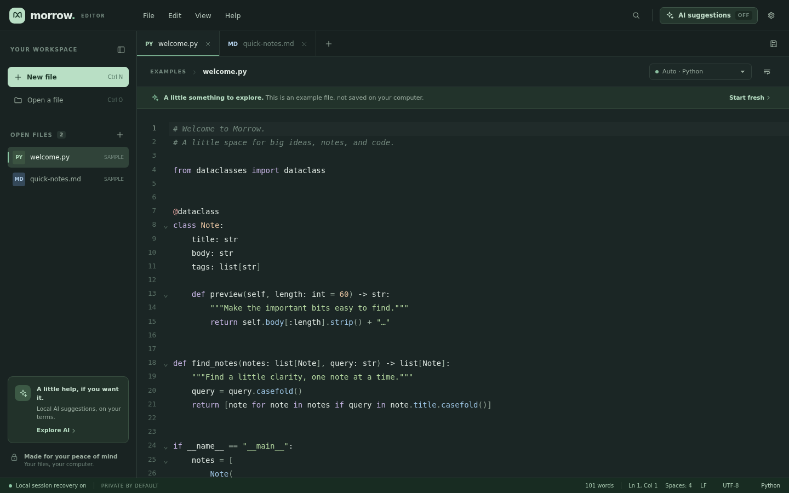

# Morrow

**A little space for notes, code, and everything in between.**

Morrow is an early, free and open-source Windows text-editor prototype. It aims to feel as approachable as Notepad while making quick source-code edits more comfortable. Inline AI completion is optional, starts off on every launch, and uses an Ollama server on your computer. Separately, the in-app Arena assistant can ask questions, request reviewed edits or compare two models using an eligible Arena API key; cloud access may be paid. A normal-browser Arena path remains available.

> **Status: preview, not a production replacement.** Keep backups and do not rely on this prototype as your only copy of important files. It has not yet passed the Windows release, accessibility, performance, or security test matrix in `docs/RESEARCH-AND-ROADMAP.md`. “Morrow” is a working name; check trademark and app-store availability before release.



*The screenshot shows the browser preview; native Windows integration is not demonstrated here.*

## What works

- Multiple editable tabs, native open/save dialogs, drag-and-drop, undo/redo, close-with-unsaved-changes confirmation, and Windows-oriented keyboard shortcuts. When opening several files, readable files open even if others fail; the failed filenames and reasons are listed.
- Syntax coloring selected by filename or manually. The bundled CodeMirror catalog contains **143 language descriptions**, including programming, markup and SQL dialects; that number is not a count of independently verified programming languages. Highlighting is not semantic analysis or a language server.
- Line numbers, bracket matching/closing, folding where supported, multiple selections, word wrap, dark/light themes, and a configurable font and indentation width.
- Find/replace in the current file, with case sensitivity and regular expressions. Browse up to 12 selected workspace folders, create files or folders, and search saved files locally by literal text, with optional case and filename/extension filters; results navigate to files and lines.
- Quick open, go to line and a searchable command palette. Optionally remember up to 20 recent native paths; this is off by default and stored locally without encryption.
- Toggle an optional Markdown preview of the active, possibly unsaved buffer. Parsing runs in a worker; links are inactive, images are replaced by text and raw HTML is shown as text. Preview does not request document resources and never modifies the file. See the limits below.
- Review a pasted replacement against one selected range, including a bounded diff. Accepting changes only the editor buffer, as one undoable action; it never saves automatically. A stale target cannot be applied.
- Use the in-app Arena API assistant for an independent question, an explicitly reviewed selected-text edit, or a side-by-side comparison of two eligible models. A separate confirmation precedes every send; two-model comparison makes two requests and both may cost money. The ordinary browser and pasted-review path remains available; Morrow does not automate the website.
- UTF-8 (with or without BOM), BOM-marked UTF-16 LE/BE, and LF/CRLF/CR detection and output. Invalid UTF-8, UTF-32 BOMs, and text containing NUL are rejected. The app cannot detect every binary or legacy-encoded file. Mixed line endings are flagged; saving normalizes them after confirmation.
- Opt-out local session recovery, including unsaved content; local snapshots are **unencrypted** and are not a backup.
- Optional, opt-in, single-line inline AI suggestions from a locally addressed Ollama server. Tab accepts a suggestion; Esc dismisses it. The active document's nearby text is sent to Ollama only after opt-in; see **Privacy** below.
- Save-time external-change check and same-directory temporary-file replacement for native saves. This mitigates common accidental overwrites, but is not a transactional guarantee across all filesystems; see limitations below.

Example buffers are intentionally labeled **SAMPLE**. They are editable but are not files on disk until you save them.

## Run the Windows application from source

**Prerequisites:** Windows 10/11 x64, Node.js 20 or newer, Rust stable (1.90+), Microsoft C++ Build Tools with **Desktop development with C++**, and the Microsoft Edge WebView2 runtime. See [Tauri's Windows prerequisites](https://v2.tauri.app/start/prerequisites/).

Open PowerShell in this project directory:

```powershell
npm ci
npm run tauri dev
```

Build an unsigned Windows x64 installer on Windows:

```powershell
npm ci
npm run tauri build -- --target x86_64-pc-windows-msvc
```

The NSIS setup executable is generated under `src-tauri/target/x86_64-pc-windows-msvc/release/bundle/nsis/`. Unsigned builds can trigger Microsoft Defender SmartScreen; obtain and configure a code-signing certificate before public distribution. The installer uses the WebView2 download bootstrapper if the runtime is missing, so that step may require internet access. It is **not** an offline installer.

The included `.github/workflows/windows.yml` is configured to produce an unsigned Windows x64 installer as a GitHub Actions artifact. Check the repository's **Actions** tab for the latest build result; an artifact is not a tested public release. No signed Windows release is available yet.

### Browser preview (not the Windows application)

```sh
npm ci
npm run dev
```

Open the address Vite prints. This preview exercises the same editing UI. Depending on browser support and permissions, it may use the File System Access API or download a copy when saving; it cannot access native Windows dialogs, file associations, or your PC's Ollama service. It does **not** demonstrate Windows integration.

## Set up optional AI suggestions

1. Install and start [Ollama for Windows](https://ollama.com/download/windows).
2. In a terminal, download the recommended model:
   ```powershell
   ollama pull qwen2.5-coder:1.5b
   ```
   The model download is separate (approximately 1 GB as of October 2026); inference uses your own CPU/GPU and memory.
3. In the **Windows app**, open **AI suggestions**, read the consent notice, and turn the switch on. Consent lasts only until the app exits; enabling AI again requires another explicit choice. Use **Check connection** if needed. No account or API key is required for a local Ollama model.
4. Type code and pause for a suggestion; press **Tab** to accept or **Esc** to dismiss. `Ctrl+Shift+Space` requests one manually.

The implementation uses Ollama's [`/api/generate`](https://docs.ollama.com/api/generate) fill-in-the-middle `prompt` and `suffix` fields, which require a compatible model. Suggestions are currently **single-line**, may be wrong, and are not semantic/LSP-aware. The quality and latency depend on the model and your computer.

## Folder browsing and navigation

1. Choose **File → Open folder** or **Open a folder** in the sidebar and read the access notice. Opening a folder replaces the folder view but does not close open files. To work on several projects, choose **File → Add folder to workspace** or the plus button in the folder heading. You can add up to 12 explicitly selected roots. Expand each project and subfolder to browse; remove an individual root with its × button, or close the workspace. **Removing a folder never deletes it or closes its open tabs.** The workspace list is session-only and is not automatically restored; Morrow does not read or write VS Code `.code-workspace` files.
2. Use the **+** beside a project or subfolder to create a file or folder inside it. Creation is an explicit disk operation: a new file starts empty on disk immediately, then opens for editing; saving edits remains separate. Native creation checks names, the selected root, link/reparse-point parents, and existing destinations; it uses exclusive creation rather than truncating an existing entry. It does not provide rename, delete, drag-and-drop moving, or full VS Code workspace parity. Browser preview cannot atomically distinguish an existing entry that appears during creation, though it does not truncate it; see the safety notes below.
3. Press `Ctrl+Shift+F` to search **saved files on disk across all selected roots**, not unsaved editor buffers. Searches are literal, single-line and return at most one result per matching line. Filters are comma-separated extensions or exact filenames, for example `.ts, *.md, README.md`; they are not general glob patterns or regex. Editing the query or filters clears old results until you search again. Click a result to open it at that line. If the file is already open with unsaved changes, or its on-disk contents have changed since it was opened, the saved-file result can point to a different position in the buffer and Morrow warns you.
4. Use `Ctrl+P` for open tabs, selected folders and opted-in recent native file paths; `Ctrl+G` for a line; and `Ctrl+Shift+P` for the command palette. Quick open shows up to 100 matching items at once—refine the search to see others.

Browsing is lazy. Search and quick-open traversal skip `.git`, `.hg`, `.svn`, `node_modules`, `target`, `dist`, `build`, `coverage`, `.cache`, `.next` and `.venv`; other generated directories and dotfiles may be included. A directory scan is capped at its first 2,000 entries (before sorting); a whole-workspace traversal at 5,000 files and 1,000 directories; each searched file at 2 MiB; and results at 500 matching lines. These are combined limits, not per-root allowances. Invalid or binary-looking text and unreadable items are skipped. The UI reports skipped items, errors and safety-limit truncation, so an incomplete search must not be interpreted as exhaustive. If roots overlap, the same file may occur more than once in search results. File opening has the separate 20 MiB limit. Searching does not replace files or modify the disk.

Desktop folder enumeration, reads and creation attempt to reject symbolic links, non-regular files and Windows reparse points, and native reads are bounded. Creation rechecks each parent and uses an exclusive final create. This is **not** a sandbox against a hostile or changing filesystem: parent-directory links, reparse points and time-of-check/time-of-use races are not comprehensively prevented. On desktop, choosing a folder grants recursive file-access scope, which Tauri's persisted-scope plugin can retain after the view closes or the app restarts. Closing the view or clearing recent files does not revoke that scope. The browser preview requires a browser supporting the File System Access API; browser creation cannot guarantee exclusive creation against another process racing to create the same name.

## Markdown preview

Use the **Preview** button, **View → Toggle Markdown preview**, or the command palette to preview the active buffer as Markdown. It updates while you edit and follows the selected tab. Headings, emphasis, code, lists, blockquotes and tables are supported; exact rendering can differ from other Markdown applications. The preview is intentionally conservative: raw HTML is displayed as text, links cannot be clicked and images are replaced with placeholders. No document-specified URLs or local images are loaded. It works without an AI provider or account.

Parsing runs in a separate worker. To protect responsiveness, the preview refuses documents over 150,000 UTF-16 code units or output over 5,000 nodes, and stops waiting after eight seconds. These are preview-only limits: the buffer is unchanged and the regular 20 MiB file-opening limit still applies. The preview is not a security audit or a full CommonMark implementation. It was tested in Chromium and a Linux native WebKit smoke test; Windows WebView2 remains to be tested.

## Arena and reviewed changes

**Direct API path (desktop only):** Open **Arena** from the top bar or **Edit → Arena**. Enter your own eligible Arena API key and an enabled model ID. Choose **Ask a question** (no selection required) or **Propose an edit to selection** (select text in the editor first, then choose **Capture selection**). Inspect the question and captured text, then choose **Send to Arena** and confirm the cloud-consent dialog. The key is held only in memory and cleared when the panel closes; do not paste it into the editor or share it in support messages.

For a side-by-side comparison, enable **Compare two models** and enter two distinct model IDs your account can use. The confirmation identifies both models and explains that **two separate requests** are made and both may incur charges. This is Morrow's comparison of API responses, not the Arena website's blind battles, voting, rankings, or website login. Partial failures are shown per model.

Morrow sends the question or instruction (up to 4,000 UTF-16 code units), explicitly captured selection if any (up to 12,000), a fixed task instruction and model ID to `https://api.arena.ai/v1/chat/completions`. It does not add the file path or other files, although your text can contain them. Each request is independent: previous questions and answers are not sent. Redirects are disabled; requests can be cancelled and time out after 60 seconds. Responses are displayed as inert text; an edit requires a separate **Review this edit** step and explicit apply, and is never saved automatically. The API key, question, selection and response are cleared from the panel on close and are not intentionally stored by this feature.

**Manual browser path:** Select the text you intend to change. Open **Arena → Prefer the Arena website? → Open Arena in browser**. Sign in and use Arena's normal website yourself; copy only what you decide to share. Back in Morrow choose **Review a pasted change**, paste the replacement, compare it with the selection and explicitly apply or reject it. No website login or scraping is performed by Morrow.

A small local check warns about a few potential credential patterns in the selection and instruction before an API request. It **can miss secrets or flag harmless examples**, does not verify or redact anything, and is not a security scanner. No warning does not mean the content is safe. Always review what you send; the check does not inspect text manually copied to the browser or text sent to Ollama.

Arena website login is **not** API authorization. The default model ID `coding-router-preview` comes from [Arena's API documentation](https://platform.arena.ai/docs/opencode), but API availability, compatible keys/models, free-tier restrictions, billing, limits and terms can change. In particular, a free-router key may be limited to other integrations. Check your own account and current terms; no free access or particular model is promised. A synthetic Linux desktop request with an invalid key returned HTTP 401, exercising the consent and error path; a successful authenticated Arena response has not been verified. Arena and its model providers receive the text you send; check their current API-specific privacy, retention and training terms before sending sensitive information. The website and API can have different policies.

In either workflow, review works on **one nonempty selected range** (up to 100,000 UTF-16 code units). Replacement is applied literally—Markdown fences and explanatory prose are not removed—and line breaks are normalized for the editor. The preview may be truncated or unavailable for a large/complex diff; compare the two complete text boxes before accepting. An empty replacement is not accepted; delete text directly in the editor instead. Applying is a single, isolated undo step and does not save. If the target document changes or closes after capture, Morrow refuses the change. Review AI output critically; it can be wrong or unsafe.

## Privacy and storage

- Inline Ollama AI starts off on every launch, even if an older version stored an enabled setting. It runs only after explicit consent for the current session; that consent is not persisted. When enabled, at most 3,500 UTF-16 code units before and 1,200 after the cursor are sent to `http://127.0.0.1:11434`; Morrow does not add the file path, but the text itself may contain one. Requests are cancelled/ignored when edits or cursor changes make them stale. Morrow contains no analytics or account system. The separate, optional Arena API is a **cloud endpoint** and sends only your explicit question or instruction and optional captured text, plus a fixed task instruction, after per-request confirmation, as described above.
- A loopback address by itself does **not** guarantee that Ollama or a selected model will never forward data: [Ollama documents cloud models through its local API](https://docs.ollama.com/api/authentication). Choose a genuinely local model, inspect its configuration and [disable cloud features in Ollama](https://docs.ollama.com/cloud) if appropriate. Follow your organization's policy. Model downloads and installing WebView2 can require network access.
- Session recovery is on by default and stores open document text, unsaved text, file paths, cursor positions and related metadata in the local WebView IndexedDB database. Settings are stored in local storage. They are not encrypted by Morrow; OS disk encryption and access controls are separate. Turning off **Remember my session** attempts to delete the current stored session; deletion is not a secure erase. If it fails, a persistent warning offers **Retry removal**. File-access scopes are separately persisted by Tauri to restore access after restart.
- Recent native paths are off by default. If enabled, up to 20 are saved in local storage, unencrypted. Turn the setting off or choose **Clear recent files** to remove that list; Morrow warns if storage failure prevents clearing it. Recent-file storage is independent of recovery snapshots and the Tauri persisted file-access scope.
- If settings cannot be saved, Morrow warns that changes—including a recovery opt-out—may revert after restart. If settings cannot be read, recovery is paused and an existing snapshot is left untouched. If a snapshot cannot be read or is incompatible, Morrow also pauses recovery rather than replacing it with example files; save new work separately. An explicit confirmation is required before deleting an unreadable snapshot.
- Recovery snapshots are normally written after about 1.2 seconds of inactivity and on a normal native-window close. They can fail, be cleared, or miss the latest keystrokes during a crash. Failed snapshot writes trigger a persistent warning and, if recovery is still unavailable on exit, an unsaved-work prompt. **Save and back up important work.**

## Current limitations and safety notes

- There is a **20 MiB per-file limit**. Large-file streaming, ANSI/legacy code pages, UTF-32, exact preservation of mixed line endings, and binary/hex editing are not implemented.
- Native save writes a temporary file in the destination directory and replaces the destination after flushing. New destinations use nonempty validated IPC metadata and exclusive no-clobber creation; if a different destination already exists, Morrow asks again before overwriting even if the system dialog already confirmed it. It needs write access to the directory; saving through a symbolic link or reparse point is rejected. Metadata/ACL preservation, power-loss durability, network shares, file locks, and Windows-specific edge cases need testing. A small race remains between the external-change check and replacement. Do not assume it is as robust as a mature editor.
- Folder search is intentionally limited, literal and read-only, as described above. There is no folder-wide replace, extension marketplace, macros, debugger, language-server integration or agent with direct file editing. Local completion and optional Arena review are not a full Copilot replacement.
- Recovery is best-effort and is not an encrypted vault. If the app cannot refresh a clean restored file from disk, it displays the locally stored copy and warns; unsaved drafts retain their original disk hash for the next save check.
- An installed file association and command-line launch handler are configured but require verification on consumer Windows machines. The 0.3.0 x64 candidate passed a targeted packaged-app smoke test on a GitHub-hosted Windows Server 2025 VM, including new-file save, external-edit conflict, multi-root search and creation. Consumer Windows 10/11, file associations, scaling and broader native behavior still require validation before release. A 0.3.0 Linux Tauri development-build smoke test saved a new synthetic file, detected an external edit, browsed two selected folders, created and saved a file, refused a collision and searched across both roots. An earlier 0.2.0 Linux test rendered Markdown and received HTTP 401 from Arena with an invalid key; an earlier 0.1.0 test exercised inline AI against a mock loopback service. These do not verify Windows behavior, an authenticated Arena response or a real local model.
- With working session recovery enabled, a normal native-window close keeps unsaved tabs in the local recovery snapshot rather than prompting for each one. Closing an individual dirty tab prompts. If recovery is disabled, paused, or a close-time snapshot fails, the app prompts about unsaved tabs. Recovery is not a backup.
- The Rust lockfile contains `glib` 0.18.5 through Linux GTK/WebKit dependencies, with an outstanding upstream [advisory](https://github.com/advisories/GHSA-wrw7-89jp-8q8g). The Windows target dependency tree does not select `glib`; Linux builds need an upstream-compatible fix. This is not a complete security assessment.
- Accessibility, high-contrast themes, localization, security review, signed release infrastructure, benchmark numbers, and updates are still release blockers. No comparative speed or memory advantage is claimed without measurement.

## Shortcuts

| Action | Shortcut |
|---|---|
| New / open / save | `Ctrl+N` / `Ctrl+O` / `Ctrl+S` |
| Save as / close tab | `Ctrl+Shift+S` / `Ctrl+W` |
| Find / replace | `Ctrl+F` / `Ctrl+H` |
| Find in folder / quick open | `Ctrl+Shift+F` / `Ctrl+P` |
| Go to line / command palette | `Ctrl+G` / `Ctrl+Shift+P` |
| Next / previous tab | `Ctrl+Tab` / `Ctrl+Shift+Tab` |
| Toggle sidebar / wrap | `Ctrl+B` / `Alt+Z` |
| Settings | `Ctrl+,` |
| Request AI / accept / dismiss | `Ctrl+Shift+Space` / `Tab` / `Esc` |

## Development and tests

```sh
npm ci
npm run build
npm test
npx playwright install --only-shell chromium
npm run test:e2e        # starts the preview server automatically
```

Rust backend tests (with the [Tauri platform prerequisites](https://v2.tauri.app/start/prerequisites/) installed):

```sh
cargo test --manifest-path src-tauri/Cargo.toml --lib
```

The tests cover settings/AI-consent failures, recovery preservation and removal, partial file-opening failures, selected color-contrast checks, folder-search limits and cancellation, change-review validation/undo, Markdown preview limits and inert rendering, credential-warning heuristics, and an injected Arena transport. Browser tests use mock folder handles and inject storage/picker failures; Arena tests use a fake transport, not a live API key. Native Rust tests exercise bounded listing/reading, exclusive creation, metadata validation and file writes; they do not test all Windows reparse-point races or every filesystem. None substitutes for hands-on Windows/WebView2 testing, a real Arena API request or a complete accessibility/security audit. The Windows workflow is configured to run the browser tests as well as the frontend and Rust tests.

The frontend is TypeScript, CodeMirror 6 and Vite. The Windows shell and native file handling use Tauri 2 / Rust and the system WebView2 runtime; language modes are loaded on demand. See [`docs/PRODUCT-RESEARCH-2026.md`](docs/PRODUCT-RESEARCH-2026.md) for current product research and the proposed roadmap, and [`docs/RESEARCH-AND-ROADMAP.md`](docs/RESEARCH-AND-ROADMAP.md) for the earlier technical plan.

## License

[MIT](LICENSE) for this project's code. Dependencies and any separately downloaded AI models have their own licenses; review them before redistribution. See [`THIRD_PARTY_NOTICES.md`](THIRD_PARTY_NOTICES.md) for an initial direct-dependency inventory and the remaining distribution audit. The suggested `qwen2.5-coder:1.5b` model is distributed separately under its own terms.
