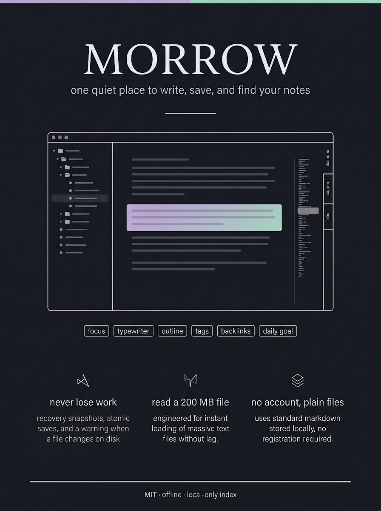

# Wrytrove at a glance

*This poster is a diagram, not a screenshot. It is checked in as a single image so a reader can
grasp the product in one glance before installing anything.*

## What Wrytrove is

Wrytrove is a small desktop editor for **plain text and Markdown files you already own**. It opens
one or more folders, edits the files in place, and never keeps your writing in a database you
cannot read. It is built with Tauri 2, CodeMirror 6 and TypeScript, and it is MIT licensed.

It is deliberately *not*:

- a knowledge platform with its own sync service,
- an IDE with a terminal, debugger and extension marketplace,
- an AI product that rewrites your file while you are not looking.

## The three promises

| Promise | Why it matters | Where it lives in the code |
| --- | --- | --- |
| **Never lose a draft silently** | The loudest complaint across notepad and note apps is a save that quietly did nothing. | Atomic saves and stale-target rejection in `src/platform.ts`; optional unencrypted session recovery in `src/storage.ts`; an on-disk change warning with an explicit reload button. |
| **Open the big file anyway** | People reach for a notepad *because* the other tool refused to open the log. | Bounded native reads, a large-document path in `src/word-stats.ts`, and a minimap that disables itself above 400,000 characters instead of freezing. |
| **No account, no upload** | You should not have to create an identity to type a sentence. | Plain files, a local-only note index (`src/note-index.ts`), explicit per-session AI consent, and an assistant panel that is off until you turn it on. |

## A day with Wrytrove

**Morning — capture before you are ready to write.**
`Ctrl+Alt+N` opens quick capture. One line about the thing you must not forget lands in
`Inbox.md`, timestamped and appended — never overwriting what was already there. If the folder
does not exist yet, `Ctrl+Alt+D` creates today's dated note from a template.

**Mid-morning — write.**
The daily goal chip in the status bar shows words written *today*, counted only as positive
deltas per document, so deleting a paragraph does not fake progress. `F8` dims everything but the
paragraph you are in; `F9` keeps the caret vertically centred; `F11` hides the chrome entirely.
The minimap on the right shows the shape of the whole document, so a long note has a map.

**Afternoon — find things.**
The Notes rail holds three views of the same folder:

- **Outline** — every heading, one click away, also available as a filterable palette with `Ctrl+Shift+O`.
- **Tags** — `#tag` in the text and `tags:` in front matter, for this note and across the index.
- **Links** — `[[wiki links]]` out of this note, backlinks into it, and the orphans nothing links to.

The index is built locally, on demand, and can be cleared from the menu. Nothing is uploaded.

**Evening — trust the save.**
If a file changed on disk while you were writing, Wrytrove says so and offers a reload; it does not
merge behind your back. Recovery snapshots are opt-in and described honestly as *not a backup*.

## How this compares

| Capability | Wrytrove | Obsidian | Typora | Notepad++ / Notepad3 |
| --- | --- | --- | --- | --- |
| Plain local files | ✅ | ✅ | ✅ | ✅ |
| Focus / typewriter mode | ✅ built in | ⚠️ plugin or theme | ✅ | ❌ |
| Backlinks and tag index | ✅ local, on demand | ✅ core | ❌ | ❌ |
| Daily notes and templates | ✅ | ✅ | ❌ | ❌ |
| Reading time and daily goal | ✅ | ⚠️ plugin | ⚠️ word count only | ❌ |
| Opens very large files | ✅ with graceful degradation | ⚠️ | ⚠️ | ✅ (EmEditor class) |
| No account, no sync service | ✅ | ✅ | ✅ | ✅ |
| Cost | free, MIT | free, proprietary | paid | free |

The point of the table is not that Wrytrove wins every row. It is that no single competitor offers
*the writing surface* (focus, typewriter, goal, minimap) **and** *the notes surface* (outline,
tags, backlinks, daily notes) **and** *the notepad virtues* (instant open, huge files, encoding
control) in one quiet, account-free window.

## What is not done yet

- Everything above is implemented and covered by unit tests, but the Windows build has not been
  exercised end to end by a second person, and no screen-reader audit exists yet.
- The focus-mode dimming contrast and the announcement of mode changes are tracked as roadmap item
  `wrytrove-015-focus-mode-a11y`.
- Quick capture and daily-note writes have re-entrancy and partial-write guards tracked as
  `wrytrove-016-capture-and-daily-guards`.
- Saving an ordinary open tab does not yet refresh the note index; that is
  `wrytrove-014-note-index-refresh-on-save`.

Those three are real gaps, filed as work rather than described as shipped.
